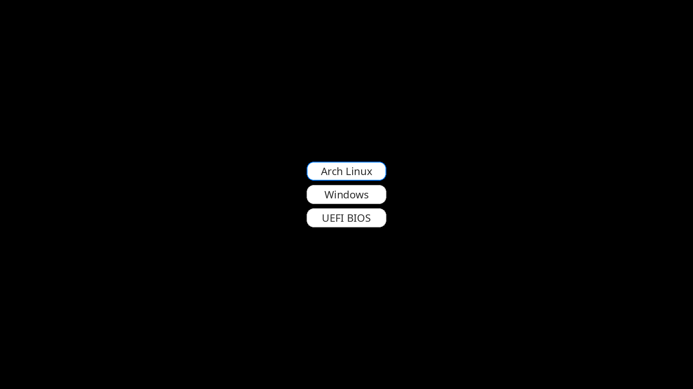

# grub-loading — финальный визуальный комплект GRUB + Plymouth

Версия: **2026-10-23**. Это самодостаточный набор для повторения текущего
оформления на другой (чистой) системе Arch Linux:

- **GRUB**: чёрный фон, три белые плашки со скруглением, тёмные подписи,
  синяя рамка у выбранного пункта. Без фоновой картинки.
- **Plymouth**: чёрный фон, синий логотип Arch и белая надпись «Arch Linux».
  Без спиннера. При выключении/перезагрузке — чёрный экран.

Важно: сама тема GRUB рисует плашку под **каждый** пункт меню. Ровно три
пункта (`Arch Linux`, `Windows`, `UEFI BIOS`) появляются только после
установки статического `40_custom` — это отдельный шаг, см. раздел 2.




Комплект рассчитан на **1600×900** (GRUB_GFXMODE). Plymouth центрируется
на любом разрешении; GRUB-тема — пиксельная, для другого разрешения см.
[`docs/GRUB.md`](docs/GRUB.md) и [`grub/tools/README.md`](grub/tools/README.md).

---

## 1. Что лежит в папке

```text
grub-loading/
├── README.md                    этот файл
├── checksums.sha256             контрольные суммы файлов
├── grub/
│   ├── install-theme.sh         установка темы GRUB (без меню)
│   ├── 40_custom.example        шаблон меню ровно из 3 пунктов
│   ├── theme/                   готовая тема noto_menu
│   │   ├── theme.txt
│   │   ├── NotoSans-Regular-24.pf2
│   │   ├── caption_0..2.png
│   │   └── plate_*.png, plate_hi_*.png
│   └── tools/                   ОПЦИОНАЛЬНО: пересчёт под другое разрешение
│       ├── README.md
│       ├── make_labels.py
│       └── make_plates.py
├── plymouth/
│   ├── install-theme.sh         установка заставки Plymouth
│   └── theme/
│       ├── arch-waves.plymouth
│       ├── arch-waves.script
│       ├── arch-logo.png
│       └── wordmark.png
└── docs/
    ├── INSTALL.md               пошаговая установка на новую систему
    ├── GRUB.md                  как устроена тема GRUB и почему
    ├── PLYMOUTH.md              как устроена заставка и почему
    ├── TROUBLESHOOTING.md       симптомы, причины, лечение
    ├── REFERENCE.md             файлы, пакеты, лицензии, checksums
    ├── preview-grub.png
    └── preview-plymouth.png
```

В комплекте **нет**:
- старых тем, волн, спиннера, `bg-waves.png`, `dot.png`;
- бэкапов и временных файлов;
- установщика загрузчика `grub-install`;
- драйверов NVIDIA и правок Windows/SSD;
- фонового демона и дисплей-менеджера.

---

## 2. Быстрый старт

Предполагается: Arch Linux, GRUB уже установлен и загружается, `/boot`
смонтирован, разрешение 1600×900.

```bash
cd /path/to/grub-loading

# 0. Проверка целостности комплекта
sha256sum -c checksums.sha256

# 1. Тема GRUB (только внешний вид; меню не меняет)
sudo bash grub/install-theme.sh

# 2. Заставка Plymouth (при необходимости скачает пакет plymouth)
sudo bash plymouth/install-theme.sh

# 3. Перезагрузка
sudo reboot
```

Если нужен **ровно три пункта** (`Arch Linux`, `Windows`, `UEFI BIOS`),
это делается отдельно через [`grub/40_custom.example`](grub/40_custom.example):
скрипт темы намеренно не отключает автоматические генераторы GRUB, чтобы
не оставить систему без загрузочной записи. Полная инструкция —
[`docs/INSTALL.md`](docs/INSTALL.md).

---

## 3. Что именно используется

| Компонент | Значение |
|---|---|
| Разрешение GRUB | `1600x900x32` |
| Фон GRUB | `#000000`, без `desktop-image` |
| Плашки | белые `#ffffff`, рамка `#dedede` 2 px, радиус 16, 184×44, зазор 10 |
| Выбранная плашка | та же, рамка `#007aff` 2 px |
| Подписи GRUB | PNG с AA, цвет `#2b2b2b`, Noto Sans Regular 24 px |
| Шрифт GRUB | `Noto Sans Regular 24` (pf2), для терминала и скрытого boot_menu |
| Фон Plymouth | чёрный `(0,0,0)` через `Window.SetBackground*Color` |
| Логотип Plymouth | Arch, 200×200, официальный синий `#1793d1`, без TM |
| Надпись Plymouth | «Arch Linux», Noto Sans Regular 72 px, белая `#ffffff` |
| Анимация Plymouth | только плавное появление ~0.5 с; спиннера нет |
| Выключение | чёрный экран без надписей и анимации |

Подробная геометрия и API — [`docs/GRUB.md`](docs/GRUB.md) и
[`docs/PLYMOUTH.md`](docs/PLYMOUTH.md).

---

## 4. Что скачивается и что должно быть установлено

### Обязательное

| Пакет | Зачем | Когда |
|---|---|---|
| `grub` | `grub-mkconfig`, тема GRUB | уже есть на загрузочной системе |
| `mkinitcpio` | сборка initramfs | уже есть на Arch |
| `plymouth` | заставка и `plymouthd` | скачивается установщиком, если нет |

`plymouth` ставится из official-репозитория:

```bash
sudo pacman -S --needed plymouth
```

Установщик Plymouth делает это сам. Других сетевых загрузок нет: все
картинки, шрифт pf2 и скрипты уже лежат в комплекте.

### Только для пересчёта темы (опционально)

| Пакет | Зачем |
|---|---|
| `noto-fonts` | TTF Noto Sans для `make_labels.py` |
| `python-pillow` | рендер подписей в PNG |
| `filesystem` | уже содержит `/usr/share/pixmaps/archlinux-logo.svg` (логотип Arch) |

`make_plates.py` использует только стандартную библиотеку Python. Для
обычной установки на 1600×900 эти пакеты **не нужны** — готовые PNG/pf2
уже в комплекте.

---

## 5. Порядок установки и что происходит

1. **GRUB-тема** — копируется в `/boot/grub/themes/noto_menu`, в
   `/etc/default/grub` выставляются `GRUB_THEME`, `GRUB_GFXMODE`,
   `GRUB_GFXPAYLOAD_LINUX`, `GRUB_TIMEOUT=-1`, `GRUB_TIMEOUT_STYLE=menu`.
   Затем `grub-mkconfig`.
2. **Статическое меню (опционально)** — копируется `40_custom.example`
   с подставленными UUID; отключаются `10_linux`, `30_uefi-firmware`,
   `31_efi_bootnext`. Это даёт ровно три пункта.
3. **Plymouth** — ставится пакет, тема копируется в
   `/usr/share/plymouth/themes/arch-waves`, в `HOOKS` добавляется
   `plymouth` после `systemd`, в cmdline добавляется `splash`
   (для стандартного меню; в статическом `40_custom` он уже есть в
   шаблоне), выполняется `mkinitcpio -P`.
4. **Перезагрузка** — GRUB рисует чёрное меню, после выбора Plymouth
   рисует чёрный экран с логотипом и белой надписью.

Почему именно так — в [`docs/GRUB.md`](docs/GRUB.md) и
[`docs/PLYMOUTH.md`](docs/PLYMOUTH.md).

---

## 6. Проверка после перезагрузки

Ожидаемый сценарий:

1. Меню GRUB: чёрный фон, три белые плашки по центру, у выбранной —
   синяя рамка.
2. После Enter: чёрный фон Plymouth, логотип Arch и белая надпись
   «Arch Linux», без спиннера.
3. Затем обычный текстовый логин `tty1` (дисплей-менеджера нет).
4. При выключении/перезагрузке: чёрный экран, без анимации.

Команды проверки:

```bash
# тема GRUB установлена и фон чёрный
grep -E 'desktop-color|desktop-image' /boot/grub/themes/noto_menu/theme.txt

# Plymouth выбран
plymouth-set-default-theme

# Plymouth и тема попали в initramfs
lsinitcpio /boot/initramfs-linux.img | grep -E 'plymouthd|arch-waves'

# hook и splash
grep -E '^HOOKS=' /etc/mkinitcpio.conf
grep -E '^GRUB_CMDLINE_LINUX_DEFAULT=' /etc/default/grub
```

Если что-то не так — [`docs/TROUBLESHOOTING.md`](docs/TROUBLESHOOTING.md).

---

## 7. Безопасность и откат

- Установщики **не запускают** `grub-install`, **не меняют** BootOrder/NVRAM
  и **не трогают** разделы Windows/SSD.
- Перед изменениями создаётся каталог
  `/root/grub-loading-backup-<дата>/` (GRUB) или
  `/root/grub-loading-plymouth-backup-<дата>/` (Plymouth).
- Откат GRUB: вернуть `default.grub` из бэкапа и выполнить
  `grub-mkconfig -o /boot/grub/grub.cfg`.
- Откат Plymouth: вернуть `mkinitcpio.conf` и `default.grub`, затем
  `mkinitcpio -P` и `grub-mkconfig`.
- Аварийно, если Plymouth мешает загрузке: в меню GRUB нажать `e`,
  добавить `plymouth.enable=0`, затем `Ctrl+X`.

---

## 8. Документация

| Файл | О чём |
|---|---|
| [`docs/INSTALL.md`](docs/INSTALL.md) | пошаговая установка на новую систему, UEFI/BIOS, `/boot`, UUID, откат |
| [`docs/GRUB.md`](docs/GRUB.md) | устройство темы GRUB: 9-patch, геометрия, AA, draw order, terminal-border, почему нет фона |
| [`docs/PLYMOUTH.md`](docs/PLYMOUTH.md) | script-plugin, спрайты, геометрия, shutdown, HOOKS, splash, initramfs |
| [`docs/TROUBLESHOOTING.md`](docs/TROUBLESHOOTING.md) | текстовое меню, белая рамка, Plymouth не стартует, чёрный экран, откат |
| [`docs/REFERENCE.md`](docs/REFERENCE.md) | полный список файлов, пакетов, лицензий, checksums |
| [`grub/tools/README.md`](grub/tools/README.md) | пересчёт GRUB-темы под другое разрешение/тексты |

---

## 9. Лицензии и происхождение

- **Noto Sans** — SIL Open Font License 1.1; пакет `noto-fonts`.
  `NotoSans-Regular-24.pf2` — bitmap-шрифт, собранный `grub-mkfont`.
- **Логотип Arch Linux** — товарный знак Arch Linux; файл взят из
  `/usr/share/pixmaps/archlinux-logo.svg` (пакет `filesystem`).
- **Плашки, подписи, скрипты** — сгенерированы для этого проекта.
- **Фоновая картинка не используется**, поэтому лицензия CC BY-SA
  старого фона к этому комплекту не применяется.

Подробности — [`docs/REFERENCE.md`](docs/REFERENCE.md).
