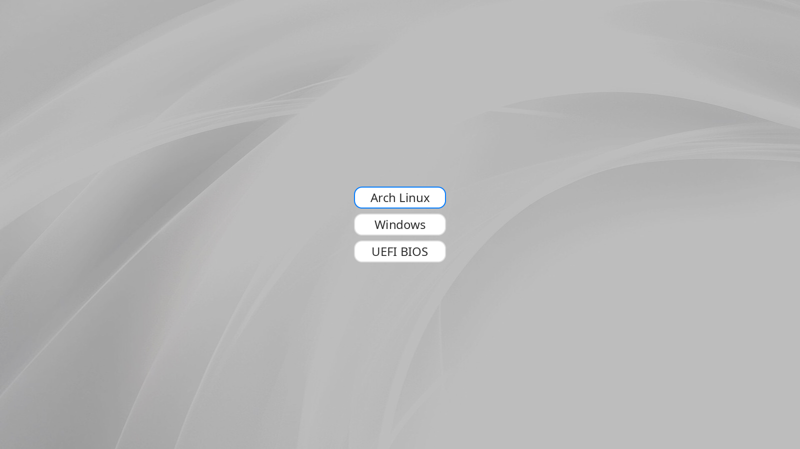

# GRUB theme «noto_menu»

Финальная белая тема GRUB: волны на фоне, три плашки по центру, подписи с
настоящим сглаживанием и синяя рамка у выбранного пункта. Без шапки «GNU GRUB»,
без нумерации, с бесконечным таймаутом и тихой загрузкой.



> Это макет, отрендеренный из тех же PNG-ассетов, что лежат в `theme/`
> (фон, 9-patch плашки, подписи). Не фотография экрана — реальный GRUB выглядит
> так же, но с учётом вашего монитора.

## Что внутри

| Элемент | Значение |
|---|---|
| Разрешение | 1600×900 (`GRUB_GFXMODE=1600x900x32`) |
| Фон | `bg-waves.png`, белые волны, затемнение 25 % |
| Плашки | 184×44, скругление 16 px, рамка `#dedede` 2 px, зазор 10 px |
| Выбранный пункт | та же плашка с синей рамкой `#007aff` |
| Подписи | RGBA-PNG, полный AA, цвет `#2b2b2b`, 24 px |
| Пункты | `Arch Linux` / `Windows` / `UEFI BIOS` |
| Загрузка | `quiet loglevel=0 systemd.show_status=no udev.log_level=0` |
| Терминал | чёрный, без белой рамки (`terminal-border: "0"`) |

## Требования

* Arch Linux с **GRUB в режиме UEFI** (тема ставится в `/boot/grub`);
* `grub` с `grub-mkconfig` и `grub-mkfont` (проверено на 2.16);
* `efibootmgr` — только если нужен пункт Windows;
* `noto-fonts` и `python-pillow` — **только для перегенерации** шрифта и подписей.

Готовые `NotoSans-Regular-24.pf2`, `caption_*.png`, плашки и фон уже лежат в
`theme/`, поэтому для обычной установки хватит `grub`.

## Быстрая установка

```bash
git clone <URL-репозитория> ~/grub-theme-noto_menu
cd ~/grub-theme-noto_menu

sudo bash apply.sh          # на вопрос ответить: да
sudo bash update-theme.sh   # синк темы и grub-mkconfig
sudo reboot
```

`apply.sh` сам вызывает `configure.sh`: тот определяет UUID корня и `/boot`,
тип файловой системы и номер Windows Boot Manager, после чего создаёт рабочий
`40_custom`. Ничего вручную вписывать не нужно.

Если Windows нет — удали пункт `Windows` из `40_custom` и переделай тему на два
пункта по инструкции `FRESH-INSTALL.md`, §10.1.

> **Важно:** `apply.sh` рассчитан на систему, где темы ещё нет. Если тема уже
> установлена, не запускай его повторно — используй `sudo bash update-theme.sh`.

## Что делает `apply.sh`

1. Делает полный бэкап в `backup-<дата>/` (`grub.cfg`, `/etc/default/grub`,
   текущий `40_custom`, список включённых генераторов).
2. Копирует `theme/` в `/boot/grub/themes/noto_menu`.
3. Отключает генераторы `10_linux`, `30_uefi-firmware`, `31_efi_bootnext`
   (`chmod -x`, файлы остаются на месте).
4. Ставит ручной `40_custom` с тремя пунктами.
5. Прописывает в `/etc/default/grub`: `GRUB_THEME`, `GRUB_GFXMODE`,
   `GRUB_GFXPAYLOAD_LINUX`, `GRUB_TIMEOUT=-1`, `GRUB_TIMEOUT_STYLE=menu`,
   тихий `GRUB_CMDLINE_LINUX_DEFAULT`.
6. Пересобирает `grub.cfg`.

`update-theme.sh` безопасно запускать многократно: он синхронизирует `theme/`
в `/boot` как зеркало, пересобирает `pf2` под размер из `item_font`, обновляет
подписи (если есть Pillow и Noto Sans) и проверяет целостность 9-patch.

## Структура

```
.
├── apply.sh              установка темы и меню
├── configure.sh          генерация 40_custom под текущую машину
├── update-theme.sh       синк theme/ → /boot и grub-mkconfig
├── revert.sh             откат по backup-*
├── 40_custom.example     шаблон меню (рабочий 40_custom — в .gitignore)
├── theme/                готовые ассеты темы
├── make_labels.py        генератор подписей (Pillow)
├── make_plates.py        генератор 9-patch плашек (stdlib)
├── make_background.py    генератор фона (Pillow)
├── backgrounds/          исходник фона и его лицензия
├── docs/preview.png      макет вида
├── FRESH-INSTALL.md      подробный гайд
├── NOTICE.md             сторонние ассеты и лицензии
└── LICENSES/             полные тексты OFL 1.1 и CC BY-SA 4.0
```

## Настройка

Подробности — в `FRESH-INSTALL.md`:

* §10.1 — убрать Windows и оставить два пункта;
* §10.2 — другие подписи и ширина плашек;
* §10.3 — другое разрешение экрана;
* §10.4 — другой размер шрифта;
* §11 — типовые ошибки (текстовое меню, шрифт, рамка, наезд плашек);
* §12 — откат и восстановление через live-USB.

Коротко о геометрии: плашка 9-patch = `item_height + 2*radius`, шаг строк =
`item_height + item_spacing`. Для 44 px и радиуса 16: `item_height = 12`,
`item_spacing = 42`. Верхнеуровневые свойства `theme.txt` — **только в кавычках**.

## Откат

```bash
sudo bash revert.sh
```

Скрипт берёт самый свежий полный `backup-*`, возвращает `grub.cfg`,
`/etc/default/grub` и `40_custom`, включает генераторы обратно и пересобирает
конфиг. Тема остаётся в `/boot`, но на неё никто не ссылается.

## Лицензии

* Код, скрипты и конфиги темы — **MIT**, см. `LICENSE`.
* Фон и производный `theme/bg-waves.png` — **CC BY-SA 4.0**, автор Davmormar;
  см. `NOTICE.md` и `LICENSES/CC-BY-SA-4.0.txt`.
* Noto Sans и производный `NotoSans-Regular-24.pf2` — **OFL 1.1**;
  см. `LICENSES/OFL-1.1.txt`.

При распространении темы сохраняй атрибуцию и лицензии из `NOTICE.md`.
